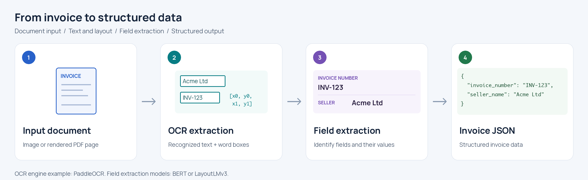

# OCR

## Context

OCR explores how to turn invoice images and PDF pages into structured data.
An OCR engine, such as PaddleOCR, extracts text and its bounding boxes. A field
extraction model identifies values such as invoice numbers, dates, seller and
customer details, and amounts. These values can then be assembled into an
invoice JSON document.



The repository focuses on dataset preparation, training, and evaluation for
invoice field extraction with BERT and LayoutLMv3. It includes Kaggle and DocILE
dataset tools, cached PDF page rendering, model diagnostics, and ClearML artifact
publication. Training can use OCR text and boxes already supplied by a dataset;
the diagram shows the overall document-processing workflow.

## CLI

Run commands from the project root after installing dependencies with `uv sync`
and configuring `.env` from [`.env.sample`](.env.sample).

| Command | Purpose |
| --- | --- |
| `uv run python -m commands.cli datasets download kaggle-invoices` | Download and prepare the Kaggle invoice dataset. |
| `uv run python -m commands.cli datasets download docile` | Download and prepare annotated DocILE documents. |
| `uv run python -m commands.cli datasets cache-images docile` | Cache PDF page images for LayoutLM training. |
| `uv run python -m commands.cli train bert-pytorch` | Train and evaluate BERT with the PyTorch training loop. |
| `uv run python -m commands.cli train bert-transformers` | Run the BERT pipeline built around Transformers Trainer. |
| `uv run python -m commands.cli train layoutlm` | Train LayoutLMv3, evaluate its best checkpoint, and publish artifacts to ClearML. |
| `uv run python -m commands.cli debug bert-pytorch` | Compare token and OCR-word decoding for a saved checkpoint. |

See the [full CLI reference](https://github.com/vsokoltsov/invoices-ocr/blob/main/docs/cli.md)
for every option, complete invocation examples, environment settings, and dataset
and training details.

## Development

Run the local checks:

```sh
uv run pytest
uv run ruff check .
uv run ty check .
```
