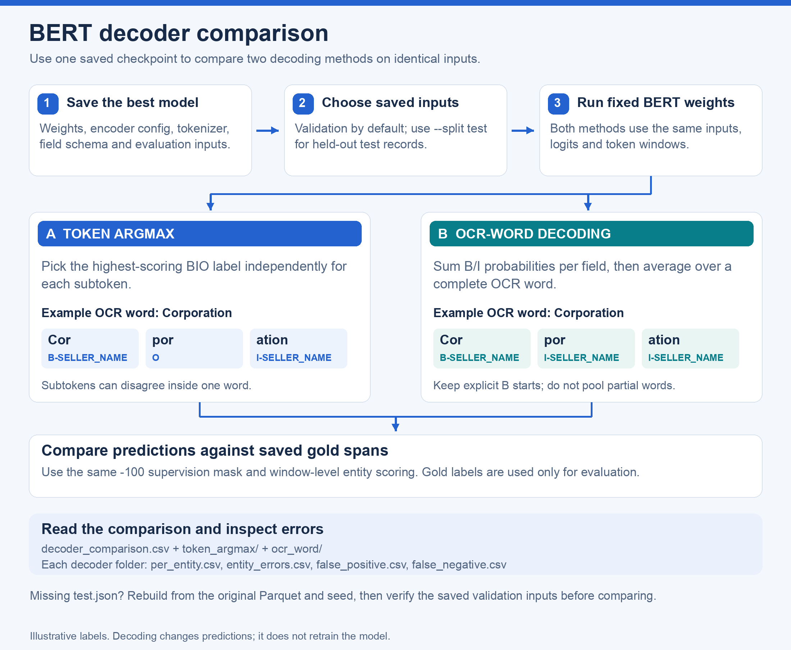
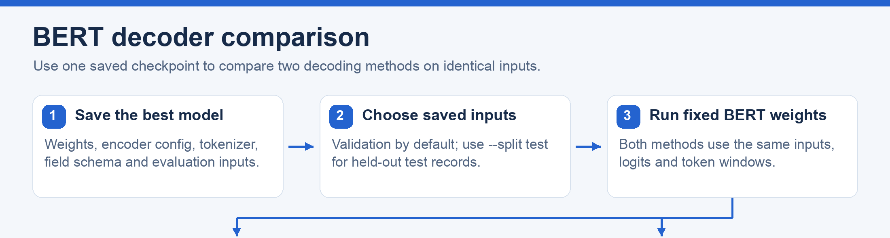
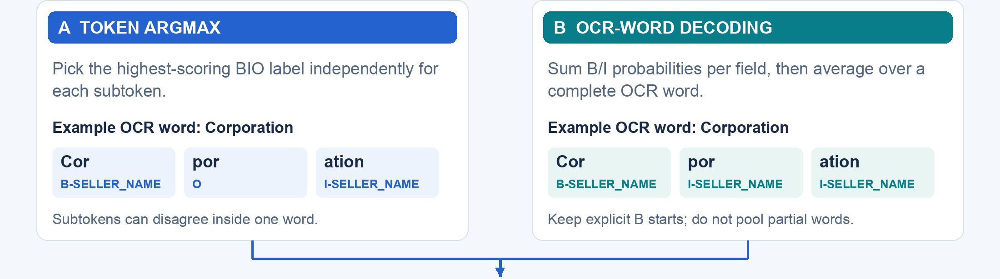
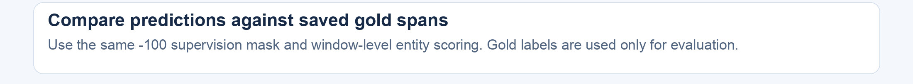
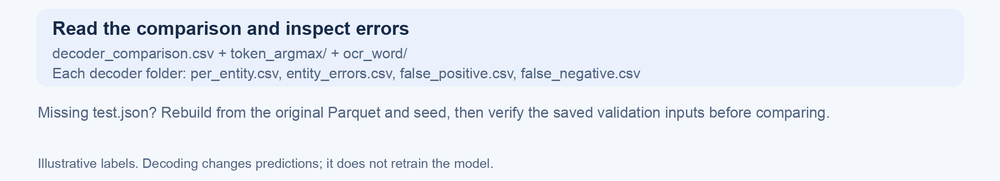

# Compare BERT decoders



## Save a checkpoint and choose inputs

Train once and save the best validation-F1 weights with their validation inputs:

```bash
uv run --env-file .env python -m commands.cli train bert-pytorch \
  --dataset-path docile_df.parquet \
  --num-epoch 20 \
  --checkpoint-dir data/interim/docile_checkpoint \
  --result-filename data/interim/docile_training \
  --diagnostic-dir data/interim/docile_diagnostics
```

The checkpoint is written when training finishes and restores the best weights.
Weights are selected using OCR-word entity F1. Each run trains one model;
use `--line-items-only` for a separate item-field experiment.
It includes the encoder configuration, model weights, tokenizer, ordered field
schema, selected epoch, window length, validation text, gold spans, ignored
regions, and OCR word offsets. It also saves held-out test records in `test.json`.
These inputs contain invoice data. Keep the
checkpoint with the same access controls as the dataset.

Compare decoders without training, downloading a model, or rebuilding the split:

```bash
uv run python -m commands.cli debug bert-pytorch \
  --checkpoint-dir data/interim/docile_checkpoint \
  --output-dir data/interim/docile_decoder_comparison \
  --device auto
```

Use `--split test` to evaluate both decoders on saved test records. The default
is `--split validation`. Use separate output directories for the two splits.



## Compare decoding methods

Token argmax selects the highest-scoring BIO label for each subtoken.

The word decoder sums B/I probabilities per entity type, averages these type
probabilities over each OCR word, and assigns one type to that word. It retains
an explicit B at a word start and uses I for the remaining subtokens. It does not
pool words that cross a token-window boundary. Separate OCR words can still have
separate entities.



## Evaluate predictions

Gold labels are used only for evaluation, with the same -100
mask and window-level scoring as training diagnostics.



## Inspect reports

Use `cpu`, `cuda`, or `mps` to select a device explicitly. The command prints the
absolute path to `decoder_comparison.csv`. It also saves `per_entity.csv`,
`entity_errors.csv`, `false_positive.csv`, and `false_negative.csv` under each of
`token_argmax/` and `ocr_word/`. Each output records the selected checkpoint epoch.



For a checkpoint without `test.json`, supply the original prepared dataset and
training split seed:

```bash
uv run python -m commands.cli debug bert-pytorch \
  --checkpoint-dir data/interim/docile_checkpoint \
  --split test \
  --dataset-path docile_df.parquet \
  --random-seed 42 \
  --output-dir data/interim/docile_decoder_test
```

The fallback rebuilds accepted records and split membership without training. It
requires the reconstructed validation text, spans, ignored regions, and document
order to match the saved validation snapshot. It fails if they differ. The test
snapshot is then saved in the debug output directory. Use the original dataset,
seed, and preparation logic; this check cannot replace a complete saved split
manifest. New training runs save test inputs directly.

## Configuration

This command requires a checkpoint with DocILE OCR words. Existing error CSVs
cannot reconstruct model weights. Checkpoints from training before checkpoint saving must be recreated.

Configuration defaults are in `BertPytorchDebugConfig`. Environment variables:

- `BERTPYTORCH_CHECKPOINT_DIR`: training checkpoint output.
- `BERT_PYTORCH_DEBUG_CHECKPOINT_DIR`: debug checkpoint input.
- `BERT_PYTORCH_DEBUG_OUTPUT_DIR`: debug report output.
- `BERT_PYTORCH_DEBUG_DEVICE`: inference device.
- `BERT_PYTORCH_DEBUG_SPLIT`: validation or test.
- `BERT_PYTORCH_DEBUG_DATASET_PATH`: original data for test reconstruction.
- `BERT_PYTORCH_DEBUG_RANDOM_SEED`: original split seed for reconstruction.

Use a distinct checkpoint directory for each training experiment. Compare both
decoders over the full saved validation set before changing inference behaviour.
