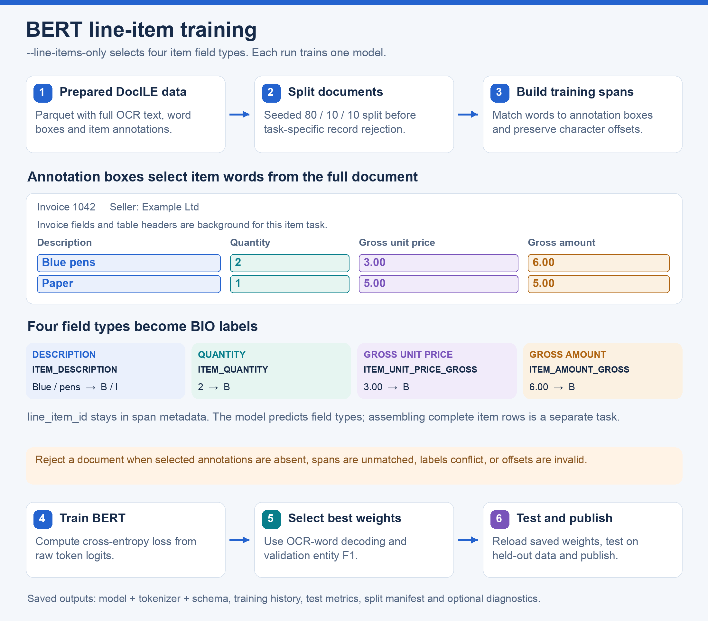
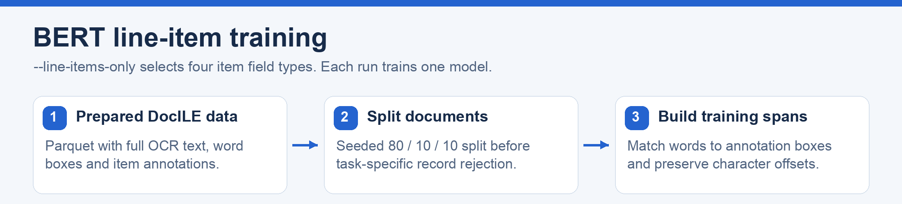
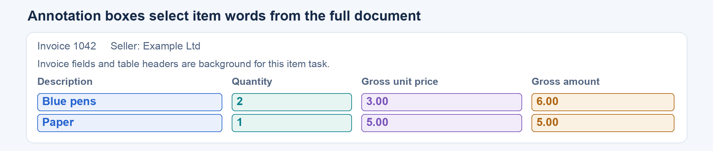
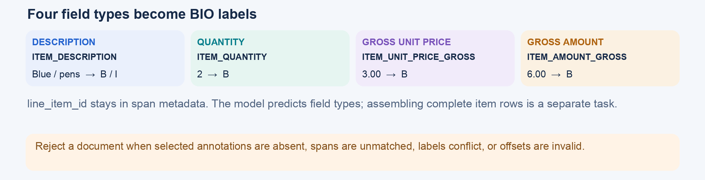
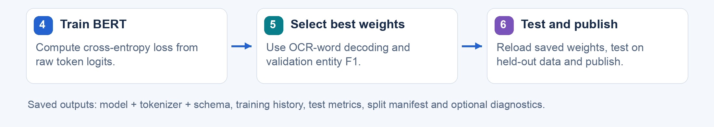

# Train DocILE line-item fields


```bash
uv run --env-file .env python -m commands.cli train bert-pytorch \
  --dataset-path docile_df.parquet \
  --line-items-only \
  --num-epoch 20 \
  --checkpoint-dir data/interim/docile_items_checkpoint \
  --result-filename data/interim/docile_items_training \
  --diagnostic-dir data/interim/docile_items_diagnostics
```



## Prepare and split documents

Each run trains one model. The default selects invoice fields;
`--line-items-only` selects item fields. Its environment default is
`BERTPYTORCH_LINE_ITEMS_ONLY=false`.

Both experiments use the same seeded 80/10/10 split when the prepared data,
row order, and random seed match. Membership is fixed before task-specific
rejection. A split manifest is saved with each checkpoint.



## Match annotations to OCR words

The builder selects OCR words by annotation boxes and pages, preserves global
text offsets, and retains `line_item_id` in spans and annotation sources. Different
items cannot merge during span preparation, even when they share a field type.
Words assigned to competing item IDs are reported as overlaps. Missing spans,
unresolved overlaps, and invalid offsets reject a document. Documents with no
selected item annotations are also rejected. The preparation log reports accepted
and rejected document counts.



## Create BIO labels

The flag selects four entity types: ITEM_DESCRIPTION, ITEM_QUANTITY,
ITEM_UNIT_PRICE_GROSS, and ITEM_AMOUNT_GROSS. The complete OCR text remains the
input. Invoice fields and table headers are not positive item labels. Net prices
and other item fields are outside this experiment's target schema.

This experiment learns field types, not item grouping. Ground-truth item IDs are
metadata and are not model inputs or classification targets. Entity F1 therefore
measures field extraction, not complete-item reconstruction.



## Train, evaluate, and publish

OCR-word decoding is used for validation, best-checkpoint selection, final test
evaluation, and diagnostics. Loss is computed from raw logits.

The saved checkpoint contains the item schema and original validation inputs.
Run `debug bert-pytorch` with this checkpoint to compare decoders for item fields.
Keep item and invoice experiments in separate output and checkpoint directories.


