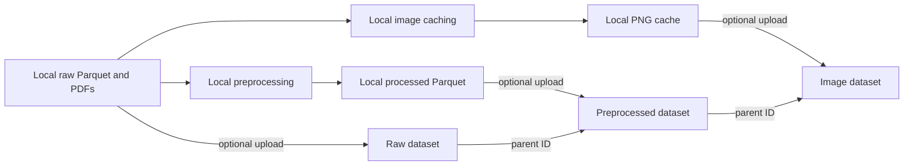

# ClearML datasets

[Back to OCR](../README.md) · [CLI reference](cli.md)

Preprocessing uses local Parquet files. It does not need ClearML credentials,
a dataset ID, or a download. ClearML storage is a separate, optional step.
Upload commands store files that already exist. They do not load DocILE source
JSON or run preprocessing.

Store three related datasets:

- Raw: original OCR and annotations in Parquet, with PDFs.
- Preprocessed: the existing processed Parquet, with the raw dataset as parent.
- Images: the existing PDF page cache, with either dataset as parent.

Use the preprocessed dataset as the image dataset's parent to download all three
parts together. ClearML inherits parent files without uploading them again.
See [ClearML Data](https://clear.ml/docs/latest/docs/clearml_data/).



## Prepare local files

The existing commands keep their local file interface:

```sh
uv run --env-file .env python -m commands.cli datasets load docile \
  --source-path ./data/raw/docile \
  --output-path ./data/raw/docile.parquet --split trainval

uv run python -m commands.cli preprocess bert \
  --source-path ./data/raw/docile.parquet \
  --output-path ./data/interim/docile.parquet

uv run python -m commands.cli datasets cache-images docile \
  --dataset-path ./data/raw/docile.parquet \
  --images-path ./data/interim/docile_images
```

Download DocILE archives first if they are not present. `preprocess layoutlm`
can replace `preprocess bert`; both write the same shared invoice schema.
These operations do not upload data. You can train directly from their outputs.

## Upload existing files

Configure ClearML credentials in `.env` or `clearml.conf` as for training.
Upload settings use `CLEARML_DATASET_PROJECT` (default: `ocr`) and
`CLEARML_DATASET_OUTPUT_URI` (default: empty, which uses ClearML default storage).
`--project` and `--output-uri` override them.

Upload raw Parquet and its PDFs:

```sh
uv run --env-file .env python -m commands.cli datasets upload docile \
  --dataset-path ./data/raw/docile.parquet \
  --project ocr --name docile-trainval-raw
```

The command prints the finalized raw dataset ID. Set `RAW_ID` to that ID in your
shell. SDK progress and connection logs can also appear. All referenced PDFs
must exist. The command uploads the Parquet and those PDFs; it does not upload
ZIP archives. Source Parquet, OCR, annotations, and PDF files remain unchanged.

Upload the preprocessed Parquet that you created locally:

```sh
uv run --env-file .env python -m commands.cli datasets upload docile-preprocessed \
  --dataset-path ./data/interim/docile.parquet \
  --parent-id "$RAW_ID" --project ocr --name docile-trainval-preprocessed
```

Set `PREPROCESSED_ID` to the printed ID. This child adds `preprocessed.parquet`
and inherits `raw.parquet` and `pdfs/`. It checks that the parent contains the
PDFs for its document IDs. It preserves processed fields, words, and annotations.
Only PDF references change in the uploaded copy. No preprocessing runs here.
The default input path is `BERTPYTORCH_DATASET_PATH`; use `--dataset-path` when
your processed file is elsewhere.

Upload the existing page cache:

```sh
uv run --env-file .env python -m commands.cli datasets upload docile-images \
  --parent-id "$PREPROCESSED_ID" \
  --images-path ./data/interim/docile_images \
  --project ocr --name docile-trainval-images
```

Set `IMAGES_ID` to the printed ID. This child uploads PNG files and inherits the
raw and preprocessed data. You can use `RAW_ID` as its parent if you only want
raw data and images. Use the cache rendered from that raw dataset version.
The image upload checks that every PDF page has a readable PNG and rejects
missing or extra pages. It reads the parent's files through the ClearML cache
to check page counts; this can download the parent if it is not cached.

Uploads create finalized dataset versions with dependency links. Use exact IDs
for repeatable runs. Create separate versions for the official `test` split.

## Download and use existing files

```sh
uv run --env-file .env python -m commands.cli datasets download clearml \
  --dataset-id "$IMAGES_ID" --destination-path ./data/docile-bundle

uv run --env-file .env python -m commands.cli pipeline layoutlm \
  --dataset-path ./data/docile-bundle/preprocessed.parquet \
  --images-path ./data/docile-bundle/images
```

The download retrieves the selected dataset and inherited files. The destination
must be new or empty. Existing files are not replaced. ClearML caches the data
before it copies files to the destination; allow disk space for both copies.

The downloaded preprocessed file is ready for the existing training commands.
To run a different preprocessing configuration, pass the downloaded raw file to
the same local command:

```sh
uv run python -m commands.cli preprocess bert \
  --source-path ./data/docile-bundle/raw.parquet \
  --output-path ./data/interim/docile-alternative.parquet
```

## PDF paths

The stored ClearML copies use paths relative to each Parquet file:

```text
docile-bundle/
├── raw.parquet
├── preprocessed.parquet
├── pdfs/
│   └── abc123.pdf
└── images/
    └── dpi_150/
        └── abc123/
            ├── page_0000.png
            └── page_0001.png
```

| Parquet location | Example `pdf_path` |
| --- | --- |
| Stored in ClearML | `pdfs/abc123.pdf` |
| Downloaded to `/workspace/data/docile-bundle` | `/workspace/data/docile-bundle/pdfs/abc123.pdf` |
| Downloaded to `/mnt/invoices` | `/mnt/invoices/pdfs/abc123.pdf` |

Upload converts PDF paths only in a temporary copy. Download converts them to
absolute paths only in the local destination copy. The remote dataset stays
unchanged. The Parquet file and all other values remain available through the
same local interfaces. No ClearML links enter preprocessing or training.

If you move an already downloaded directory, download it again at the new
location so PDF references point to the new paths.

See [the ClearML Dataset SDK](https://clear.ml/docs/latest/docs/references/sdk/dataset/)
for parent datasets, uploads, finalization, and local copies.
