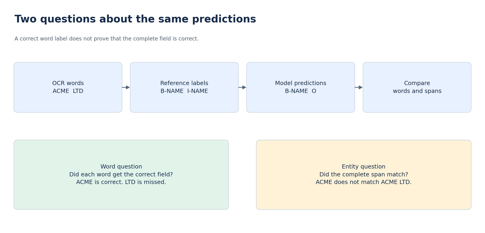
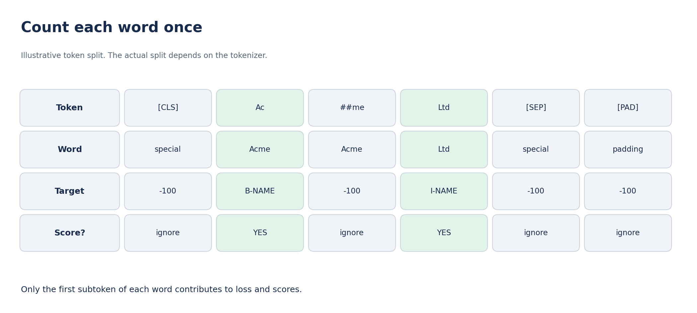
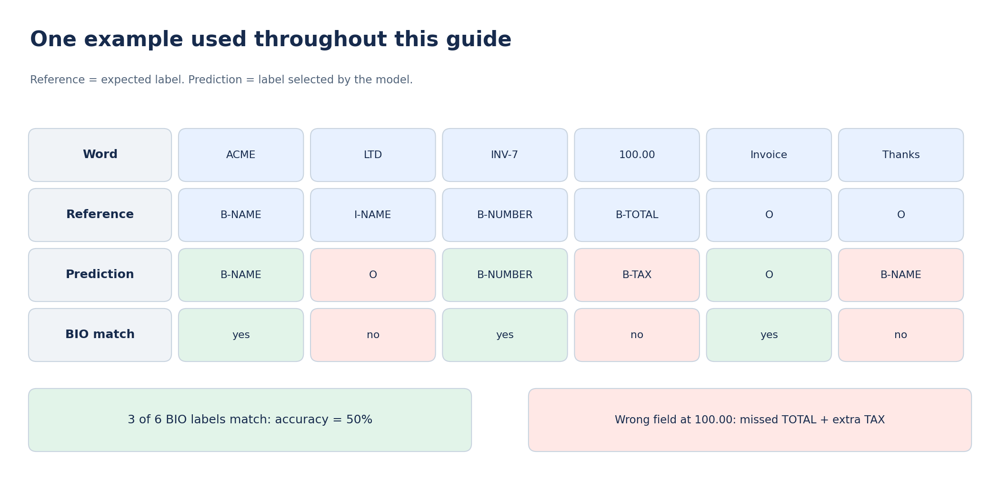
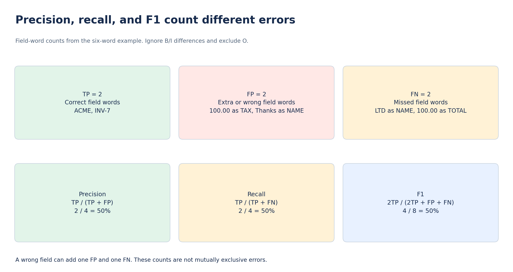
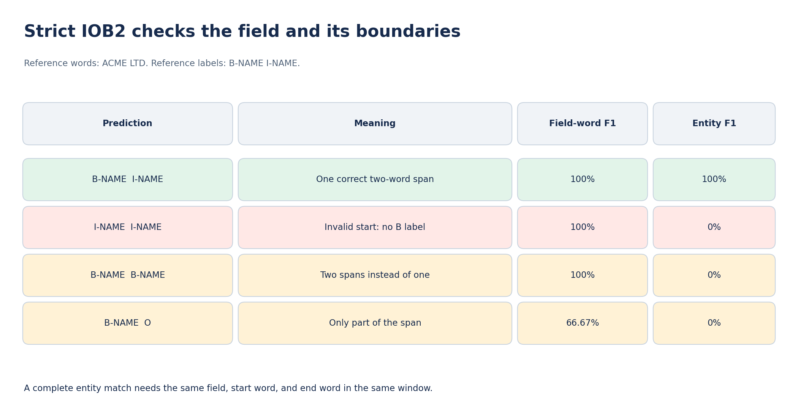
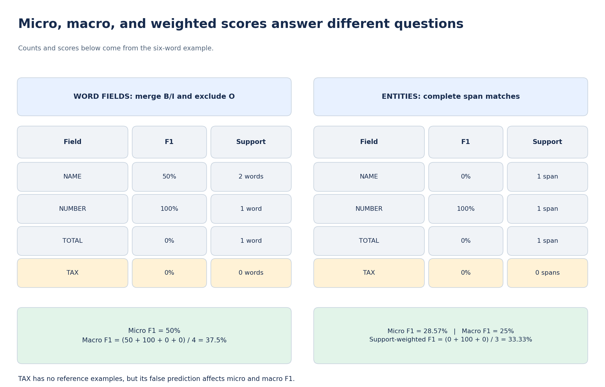
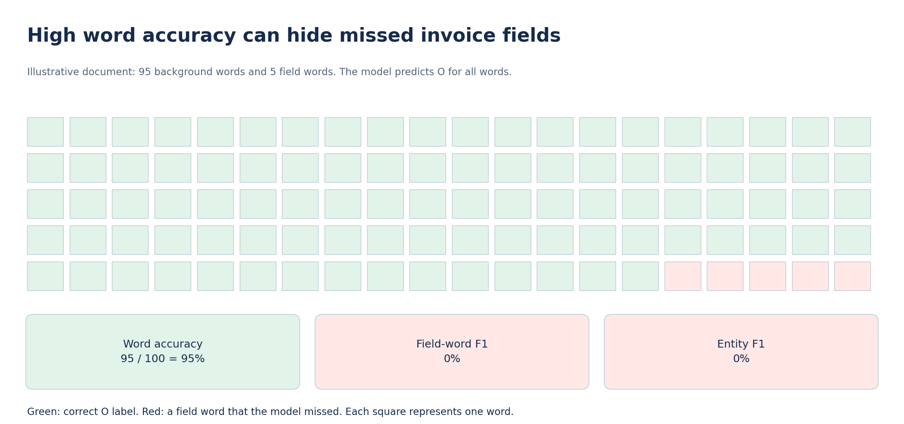
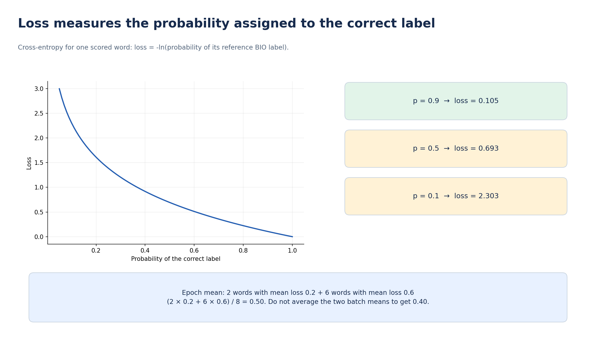
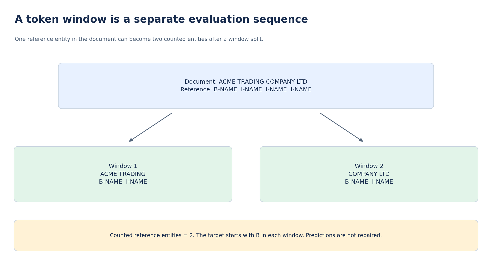
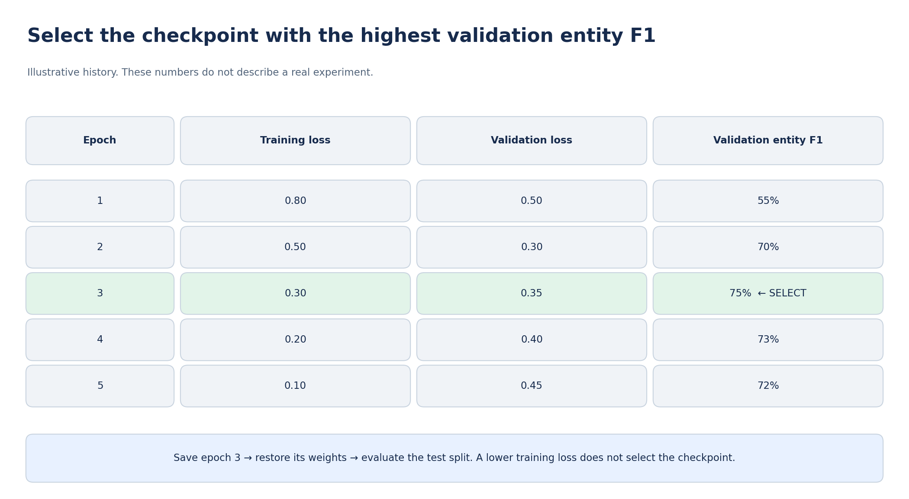

# Invoice extraction metrics

[Back to OCR](../README.md) · [CLI reference](cli.md)

A metric is a number that measures model performance. This guide explains the
metrics used by the BERT and LayoutLMv3 invoice models in this repository.

**Use `entity_f1` as the main score. Use word scores and loss to understand errors.**
Check how many documents preparation accepted before you compare model scores.



## 1. Terms used in this guide

| Term | Meaning |
| --- | --- |
| OCR word | A text unit that OCR reads from the page, with its own bounding box. |
| Field | A type of invoice information, such as seller name or total. |
| Reference | The expected label from the prepared dataset. It is also called a target or gold label. |
| Prediction | The label selected by the model. |
| Token | A model input unit. A word can have more than one token. |
| Subtoken | One token that forms part of a word. |
| Entity | A continuous span of words with one field type and defined start and end positions. |
| Window | One sequence of model input tokens. A long document needs more than one window. |
| Batch | A group of windows processed together. |
| Epoch | One pass through the training data. |
| Checkpoint | Model weights saved at a selected point in training. |
| Support | The number of reference words or reference entities for a field. |

Scores are stored as numbers from 0 to 1, except loss and support.
For example, an F1 value of `0.75` means 75%. Higher accuracy, precision, recall,
and F1 are better. Lower loss is better for the same loss definition and data.
Support is a count. It is not a quality score.

The reference can contain errors. A score measures agreement with the prepared
reference, not proof that the invoice value is correct.

## 2. Which words are scored?

Both models train and score the first subtoken of each word. The other
subtokens do not add more weight to that word.

Special tokens and padding are also excluded. Their target ID is `-100`, the
ignore value. A batch with no scored targets adds no loss or scores.



For DocILE BERT records, OCR character offsets identify word starts. Standalone
BERT span records without OCR words use tokenizer word IDs. LayoutLM uses its
OCR word alignment. Compare the same word definition when you compare models.

The default prediction is the label with the largest score at the word's first
subtoken. BERT debug runs can also use an optional OCR-word pooling decoder.
Record the decoder when you compare runs. Loss uses the original model scores,
even when a decoder changes the selected predictions.

## 3. Read BIO labels

The models use these labels:

| Label | Meaning |
| --- | --- |
| `B-NAME` | The first word of a name entity. |
| `I-NAME` | A later word in the same name entity. |
| `O` | A word outside the selected fields. |

`NAME`, `NUMBER`, `TOTAL`, and `TAX` are short example field names in this guide.
Real runs use names such as `SELLER_NAME` and `INVOICE_NUMBER`.

IOB2 is the rule for these labels. Each entity must start with `B-`.
An `I-` label must continue an entity of the same type. Seqeval is the library
that checks the sequences. IOB2 is the scheme; seqeval is the scoring tool.

## 4. A worked example

The following example has six OCR words in one window. We use it in the next
sections. It includes a missed word, a wrong field, and an extra prediction.



| Word | Reference | Prediction | Result |
| --- | --- | --- | --- |
| ACME | `B-NAME` | `B-NAME` | Correct word label. |
| LTD | `I-NAME` | `O` | A name word is missed. |
| INV-7 | `B-NUMBER` | `B-NUMBER` | Correct word label. |
| 100.00 | `B-TOTAL` | `B-TAX` | The word has the wrong field. |
| Invoice | `O` | `O` | Correct background label. |
| Thanks | `O` | `B-NAME` | An extra name is predicted. |

### BIO word accuracy: `bio_word_accuracy`

This metric checks the complete BIO label of each scored word.
`B-NAME` and `I-NAME` are different labels for this calculation.

```text
BIO word accuracy = correct BIO word labels / all scored words
                  = 3 / 6
                  = 0.50
```

The denominator includes words labeled `O`. Use accuracy to check general
label agreement. Do not use accuracy alone to select an extraction model.

## 5. Field-word precision, recall, and F1

These metrics check field assignment for individual words. They merge the
`B-` and `I-` labels for the same field. Thus, both `B-NAME` and `I-NAME` mean
`NAME` for this calculation. They do not check entity boundaries.

`O` is excluded as a field. However, an incorrect prediction involving `O`
still affects the field scores.

| Count | Meaning |
| --- | --- |
| True positive, TP | A word has the correct field. |
| False positive, FP | A word is assigned to a field that does not match its reference. |
| False negative, FN | A reference field word is not assigned to that field. |

A wrong-field prediction creates two counts. In the example, `100.00` creates
one FP for TAX and one FN for TOTAL. A correct `O` prediction adds none of
these counts.



| Report name | Calculation | Purpose and interpretation |
| --- | --- | --- |
| `field_word_micro_precision` | `TP / (TP + FP)` | Of the predicted field words, how many have the correct field? Low precision means many extra or wrong assignments. |
| `field_word_micro_recall` | `TP / (TP + FN)` | Of the reference field words, how many were found with the correct field? Low recall means many words were missed or assigned elsewhere. |
| `field_word_micro_f1` | `2TP / (2TP + FP + FN)` | Combines precision and recall. A high score needs both. |

For the worked example, TP = 2, FP = 2, and FN = 2. All three scores are 50%.
The two true positives are ACME and INV-7.

The scorer adds counts across batches before it calculates the final ratios.
It does not average the F1 values of individual batches.

If a denominator is zero, this implementation reports zero for that ratio.
When no reference field words and no field predictions exist, field F1 is zero.
This does not mean that a field was missed; check support as well.

## 6. Strict entity precision, recall, and F1

An entity is correct only when all three properties match:

1. The field type.
2. The start word.
3. The end word.

The match must be in the same evaluation window. A partial match gets no
entity credit. A span with the wrong field also gets no entity credit.



The scorer uses `mode="strict"` and `scheme=IOB2`. It does not repair invalid
prediction boundaries. For example, `I-NAME I-NAME` at a sequence start does
not form a valid name entity in strict mode. Field-word F1 can still be 100%
because both words have the NAME type.

For entity counts, TP means a complete matching span. FP means a predicted
span with no exact reference match. FN means a reference span with no exact
prediction match. Invalid IOB2 predictions are not repaired into valid spans.

| Report name | Calculation | Purpose |
| --- | --- | --- |
| `entity_precision` | `entity TP / (entity TP + entity FP)` | Measures the correctness of predicted spans. |
| `entity_recall` | `entity TP / (entity TP + entity FN)` | Measures how many reference spans were found. |
| `entity_f1` | `2 × entity TP / (2 × entity TP + entity FP + entity FN)` | Main score for complete span extraction and checkpoint selection. |

In the worked example, the reference has three entities: ACME LTD, INV-7,
and 100.00. The prediction has four entities: ACME, INV-7, 100.00 as TAX,
and Thanks as NAME. Only INV-7 is a complete match.

```text
Entity TP = 1       Entity FP = 3       Entity FN = 2
Precision = 1 / 4 = 25%
Recall    = 1 / 3 = 33.33%
F1        = 2 / (2 + 3 + 2) = 28.57%
```

Entity F1 is not the percentage of invoices that are fully correct.
It is also not an exact match score for a final JSON value.
The entity scorer measures label spans, not text normalization or JSON parsing.

## 7. Per-field scores, support, and averages

`word_metrics.per_field` reports precision, recall, F1, and support for each
configured field. Its keys use entity names, such as `SELLER_NAME`.

`entity_report` reports the same score types for entities. It uses `f1-score`
as its F1 key. It also contains `micro avg`, `macro avg`, and `weighted avg`.
Its per-field rows cover types present in the reference or predictions.

**Check the unit of support.** ACME LTD has two words but one entity.
Word support is 2. Entity support is 1. Neither count means two invoices.
A prediction-only field can have support 0 and still add false positives.



### Micro average

Add TP, FP, and FN across all field types. Then calculate precision, recall,
and F1 from those totals. Frequent fields have more effect on this score.

The top-level `entity_precision`, `entity_recall`, and `entity_f1` are micro
scores. `entity_report["micro avg"]` contains the same entity results.

### Macro average

Calculate F1 for each included field. Then take the ordinary mean:

```text
Macro F1 = sum of included per-field F1 scores / number of included fields
```

`field_word_macro_f1` includes fields present in the reference or predictions.
It excludes a field that has neither reference words nor predicted words.
It also excludes `O`. A prediction-only field is included with F1 = 0.

For the worked example, the field-word F1 values are:

```text
NAME = 50%     NUMBER = 100%     TOTAL = 0%     TAX = 0%
Field-word macro F1 = (50 + 100 + 0 + 0) / 4 = 37.5%
```

The entity macro F1 is 25%: only NUMBER has a nonzero entity F1.
Macro scores give rare fields the same weight as frequent fields.
A low macro score with a high micro score suggests weak results on some
less frequent fields. Read the per-field rows to find them.

### Support-weighted average

`entity_report["weighted avg"]` weights each field score by its reference
entity support. For F1:

```text
Weighted entity F1 = sum(field F1 × field support) / total entity support
```

In the example, NAME, NUMBER, and TOTAL each have support 1. TAX has support 0.
Weighted entity F1 is `(0 + 1 + 0) / 3 = 33.33%`.
This is not the same calculation as micro F1, which is 28.57%.

The report also has support-weighted entity precision and recall. They are
weighted means of the corresponding per-field scores. The code does not
publish a support-weighted field-word F1 metric.

Rare fields can produce unstable scores. One correct example gives 100%
recall; missing that example gives 0%. Always read the support count.

## 8. Why high accuracy can be misleading

Most invoice words can be outside the selected fields. These words have the
`O` label. A model that predicts only `O` can therefore have high accuracy.



Use word accuracy to find broad labeling problems. Use field-word F1 to check
field assignment. Use entity F1 to check complete span matches.
No single score replaces the other two checks.

## 9. Loss

Loss measures the probability assigned to the reference BIO label.
The current models use unweighted cross-entropy. For one scored word:

```text
Word loss = -ln(p)
p = model probability for that word's reference BIO label
```

Here, `ln` means natural logarithm. A correct label with probability 0.9 has
less loss than the same label with probability 0.5. A confident wrong
prediction can have high loss.



The epoch loss weights each batch mean by its number of scored words:

```text
Epoch loss = sum(batch mean loss × scored words in batch)
             / total scored words
```

Loss is not an error percentage. It can be greater than 1.
It is not the probability that a field is wrong.

Lower training loss means the model fits the training labels better.
If training loss decreases but validation loss increases, the model can be
fitting training details that do not generalize. Check validation entity F1
as well. F1 can improve while loss increases because they measure different
properties of the predictions.

Compare losses only when the labels, scored positions, loss definition, and
evaluation data are comparable. A different label set changes the task.

## 10. Window boundaries affect entity scores

Both models score each token window as a separate sequence. They do not
reconstruct full documents for entity scoring. At a window start, an entity
continuation receives a `B-` target label.



One document entity can therefore produce more than one counted entity.
Different tokenizers can produce different window boundaries, even with the
same maximum token length. Thus, shared metric code does not guarantee
identical entity evaluation units across models.

Within each window, the scorer removes ignored positions before it checks
the label sequence. Special tokens and padding do not become words.
It does not join sequences from different windows.

Use these scores as model training and extraction diagnostics. For a final
comparison of invoice outputs, also evaluate reconstructed documents and
their extracted field values. That document-level comparison is a separate
evaluation step; these metrics do not implement it.

## 11. Validation, checkpoint selection, and test results

Training updates the model weights. Validation measures the model without
updating those weights. Test evaluation measures the selected saved checkpoint
on the held-out test split.

The trainer saves weights when validation `entity_f1` is strictly greater
than the previous best value. If two epochs have equal F1, it keeps the earlier
checkpoint. The lowest loss does not select the checkpoint.



The training pipeline restores the best weights. The test step reloads the
saved checkpoint from disk. Its test scores can differ from the final epoch's
validation scores because the weights and the data can differ.

Do not repeatedly use test scores to select settings. Use validation data for
that selection. Keep test data for the final comparison.

## 12. Find the metrics in run outputs

| Location | Contents |
| --- | --- |
| `test_metrics.json` | Word metrics, entity metrics, entity report, and metric contract. |
| `history.csv` | `epoch`, `train_loss`, and scalar validation metrics for each epoch. |
| ClearML publish task, Test scalars | The six word/loss scalars and three entity scalars. |
| ClearML publish task, artifacts | Uploaded reports and history files. BERT uses the artifact name `test_metrics`; LayoutLM uses `test_metrics.json`. |

In history, validation scalar names start with `validation_`.
For example, `validation_entity_f1` is the checkpoint-selection score.
`validation_field_word_macro_f1` is a diagnostic field-word score.

An excerpt from the worked example would contain these values:

```json
{
  "metric_contract": "ocr_word_window_strict_iob2_v1",
  "word_metrics": {
    "bio_word_accuracy": 0.5,
    "field_word_micro_precision": 0.5,
    "field_word_micro_recall": 0.5,
    "field_word_micro_f1": 0.5,
    "field_word_macro_f1": 0.375
  },
  "entity_precision": 0.25,
  "entity_recall": 0.3333333333333333,
  "entity_f1": 0.2857142857142857
}
```

This excerpt omits loss and the detailed reports. Predicted label IDs alone
cannot determine loss; the model probabilities are also needed.

The contract identifies the scoring rules. Older saved reports retain their
original definitions. Do not assume that an old `token_macro_f1` means the
same thing as the current `field_word_macro_f1`.

Re-evaluate saved checkpoints to obtain current scores. Retrain to use the
current supervision and checkpoint-selection rules.

## 13. Compare two runs

Before you interpret a difference, check these items:

1. Use the same source dataset version and document split.
2. Compare the same accepted test documents. A common split seed is not enough
   when preparation rejects different documents.
3. Check the field schema, reference labels, decoder, and metric contract.
4. Check word alignment and token window boundaries.
5. Read entity precision, recall, and F1 together.
6. Read per-field scores and support. A small sample does not prove stable performance.
7. Compare complete document outputs when the goal is correct invoice values.

These scores do not measure bounding-box accuracy or line-item row grouping.
They are not the official DocILE benchmark metrics. The
[DocILE evaluator](https://github.com/rossumai/docile#tasks-and-evaluation-metrics)
checks the benchmark tasks separately.

For a generative model such as mT5, generated output tokens do not directly
match input OCR words. Compare its extracted field values against the same
document references. Word-label and BIO scores apply only if its output has
first been converted to aligned word labels with explicit rules.

## Implementation and figure sources

- [Shared window scorer](../app/extraction/metrics.py).
- [Word metrics and report definitions](../app/extraction/word_metrics.py).
- [BERT evaluator](../app/extraction/bert/evaluation.py).
- [LayoutLM evaluator](../app/extraction/layoutlm/evaluation.py).
- [Seqeval strict IOB2 rules](https://github.com/chakki-works/seqeval#usage).
- [Figure source](assets/generate_metrics_figures.py). Each figure also has an
  SVG file with the same name for use at other sizes.

All figures are explanations. They are not screenshots of measured training
runs. To rebuild the PNG and SVG files from the project root, run:

```sh
uv run python -m docs.assets.generate_metrics_figures
```
