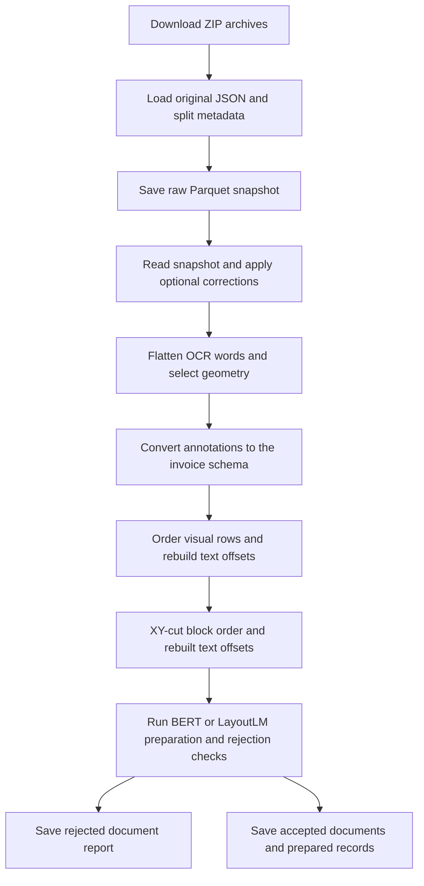
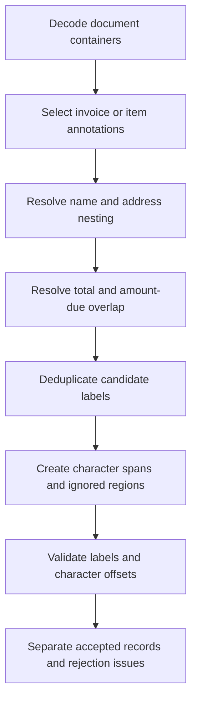
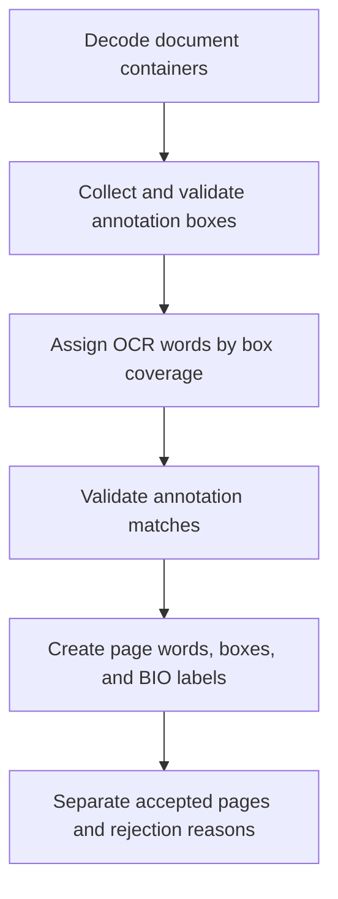

# Invoice preprocessing

[Back to OCR](../README.md) · [CLI reference](cli.md)

Downloading, reading source files, and preprocessing are separate operations.
Each preprocessing step accepts a DataFrame and returns the next DataFrame.
PipeFunc executes the steps in dependency order.

## Download and source loading

`datasets download docile` downloads and validates ZIP archives. It keeps those
archives. It does not extract them or change invoice data.

`DocileDatasetLoader` reads original OCR JSON, annotation JSON, and PDF paths.
`datasets load docile` extracts local archives if needed and saves these records
to raw Parquet. Its columns are `document_id`, `ocr_data`, `json_data`, `pdf_path`,
and available official `split` metadata. OCR and annotations use JSON strings.
PDFs remain separate files referenced by `pdf_path`.
It does not select OCR geometry, reorder words, or convert field names.

## Shared DocILE preprocessing

Run the full preprocessing pipeline with `preprocess bert` or `preprocess layoutlm`:

```sh
uv run --env-file .env python -m commands.cli datasets download docile \
  --destination-path ./data/raw/docile --split trainval

uv run --env-file .env python -m commands.cli datasets load docile \
  --source-path ./data/raw/docile \
  --output-path ./data/raw/docile.parquet --split trainval

uv run --env-file .env python -m commands.cli preprocess bert \
  --source-path ./data/raw/docile.parquet \
  --output-path ./data/interim/docile-bert.parquet
```



Both commands print progress to stdout for source loading, transformations,
model preparation, and export. They show elapsed times, input documents,
accepted documents, rejected documents and their percentage, and output records.
The rejection percentage uses all input documents as its denominator. At most
three rejection categories are shown. A document counts once per category.
Output is flushed for immediate terminal and `tee` logs. The last line is the
exported file path.

Use separate files for BERT and LayoutLM. Their rules can accept different
documents. The default output path comes from the selected model's dataset
setting; use `--output-path` to select another local file. Defaults are
`data/interim/docile-bert.parquet` and `data/interim/docile-layoutlm.parquet`.
Update existing environment variables if they still select one shared output.

The command runs [InvoicePreprocess](../app/extraction/preprocess.py) through
PipeFunc. [DocileSource](../app/datasets/docile/preprocess.py) reads the raw
Parquet and converts DocILE data. Word ordering runs next. The final
[ModelPreparation](../app/extraction/prepared.py) step calls the selected model's
preprocessor, prints statistics, and saves `<output-stem>_rejected.csv` beside
the export. If every document fails, it saves the report and stops with an error.

Each exported row is an accepted document. It retains OCR text, word boxes,
annotations, PDF paths, and available official split metadata. The additional
`prepared_records` JSON column contains the preparation settings and results:

| Model | Saved model records | Extra command option |
| --- | --- | --- |
| BERT | Text, validated character spans, and ignored regions | `--line-items-only` or `--no-line-items-only` |
| LayoutLM | Page words, integer boxes, and word BIO label IDs | `--min-word-coverage` (default 0.5) |

BERT's option defaults to `BERTPYTORCH_LINE_ITEMS_ONLY`. LayoutLM's option
defaults to `LAYOUTLM_MIN_WORD_COVERAGE`. Use the same settings for training.
A mismatch stops training and asks you to preprocess again. BERT body and item
experiments also need separate exports. PDF paths stay in the document row;
LayoutLM restores each page's PDF path from that row on the training machine.

Preprocessing reads the raw Parquet snapshot. The original OCR and annotation
JSON files are not needed for this step. The snapshot remains unchanged, and
the pipeline rejects identical input and output paths. Original PDFs are still
needed when rendering page images. Raw data and processed data have separate
paths: `DOCILE_OUTPUT_PATH` is the local raw-loader output. `DOCILE_SOURCE_PATH`
selects raw input for preprocessing and image caching; an empty value uses the
raw-loader output. Model dataset settings select the processed input for training.
Use a local `--output-path` when creating a new processed export.

The shared pipeline runs `OrderOCRWords()` followed by `XYCut()`. XY-cut uses
full-page ordering by default; no table protection is configured in the CLI.
See [XY-cut reading order](xy_cut.md) for the exact rules, diagrams, optional
table ranges, and limitations. LayoutLM annotation assignment uses the coverage
and area ranking described below.

## Component locations

| Location | Responsibility |
| --- | --- |
| `app/datasets/docile/` | Source download, original file loading, and DocILE format adaptation. |
| `app/extraction/preprocess.py` | Shared invoice preprocessing orchestration and export. |
| `app/extraction/order.py` | Initial horizontal reading order and character offsets. |
| `app/extraction/xy_cut.py` | Shared block reading order, optional table-band protection, and rebuilt offsets. |
| `app/extraction/bert/preprocess.py` | BERT annotation projection and character spans. |
| `app/extraction/layoutlm/preprocess.py` | LayoutLM word assignment and page labels. |
| `app/extraction/prepared.py` | Model preparation, saved records, rejection reports, and settings checks. |
| `app/pipelines/preprocess.py` | Shared DataFrame execution and partition reporting. |

## Model-specific preprocessing

The standalone command runs these steps before export. Training loads accepted
documents and creates seeded train, validation, and test partitions. These are
random document partitions, not the official split assignments in the export.
Training reuses saved model records without repeating annotation matching or
rejection checks. Older exports without `prepared_records` still run model
preparation during training for compatibility.

[DataFramePipeline](../app/pipelines/preprocess.py) composes ordered callables
through PipeFunc. A callable must accept one argument named `frame` and return
a DataFrame. Class configuration stays on the class instance.

The shared `DecodeDocuments` step restores Python containers from JSON strings
and Parquet arrays. `DocumentStep` catches expected per-document validation
errors, records their reasons, and skips those documents in later steps.
Unexpected errors propagate to the caller.

### BERT



The steps are in [BERT preprocessing](../app/extraction/bert/preprocess.py).
The item preprocessor selects item annotations and retains item IDs. The
matching, resolution, and rejection rules are unchanged.

[BertPreprocess](../app/pipelines/bert/preprocess.py) loads each partition's saved records,
retains OCR metadata, writes rejection reports, and saves the JSON split
manifest. Tokenization and BIO token labels are created by the later dataset
step.

### LayoutLM



The steps are in [LayoutLM preprocessing](../app/extraction/layoutlm/preprocess.py).
Candidate annotations must meet the configured word-coverage threshold. Words
select the highest coverage rounded to one decimal, then the smallest annotation
area, then the lowest annotation ID. An annotation with no assigned words still
rejects the document. The report marks it as superseded when more than 80% of a
selected annotation box lies inside it on the same page; this reason does not
make the document accepted.

[LayoutLMPreprocess](../app/pipelines/layoutlm/preprocess.py) loads each
partition's saved records, writes rejection reports, and saves the CSV acceptance manifest.
Token windows and image tensors are created later.

## Image caching and training

Run `datasets cache-images docile` with the raw dataset to render the PDF pages.
This can run before or after model preprocessing. Then run the existing `train`
or `pipeline` commands with the selected model export. Local training and
ClearML stages use the same prepared-record loader.

Model preparation prints a compact summary to stdout for each split and for
all splits together. It shows input documents, accepted documents, rejected
documents and their percentage, and output records (BERT records or LayoutLM
pages). The percentage uses source documents, not pages or token windows.
At most three rejection categories are shown. Each category counts a document
once, even if it has repeated issues; a document can have multiple categories.
The standalone `preprocess` command reports rejections across the complete
input. For new exports, training summaries show accepted input documents and
zero new rejections because preprocessing already removed rejected documents.
Older common-only exports still report rejections during training.

Filtering occurs before training splits for new exports. Models that accept
different documents can therefore have different random split membership even
with the same seed. Use a common document manifest when comparing experiments.

An empty accepted partition prints its summary and leading rejection reasons,
then stops training after its rejection report is written. A preprocessing error does not silently remove a source document
from the original dataset.

Record the source dataset version, preprocessing settings, code commit, and
split manifest with each experiment. Preserve the original data so another
preprocessing version can be compared against the same inputs.

## ClearML storage

ClearML storage is separate from preprocessing. Upload commands store existing
raw Parquet, processed Parquet, PDFs, and image caches as related datasets.
Preprocessing accepts local files or an explicit ClearML source reference.
The source loader resolves remote data before running the same DataFrame steps;
outputs remain local files. Local inputs do not need ClearML credentials.
Upload converts PDF paths in temporary copies. Download sets local absolute PDF
paths so the existing preprocessing and training commands can use either Parquet
file directly. See [ClearML datasets](clearml_datasets.md).
