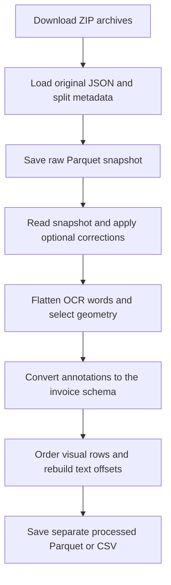
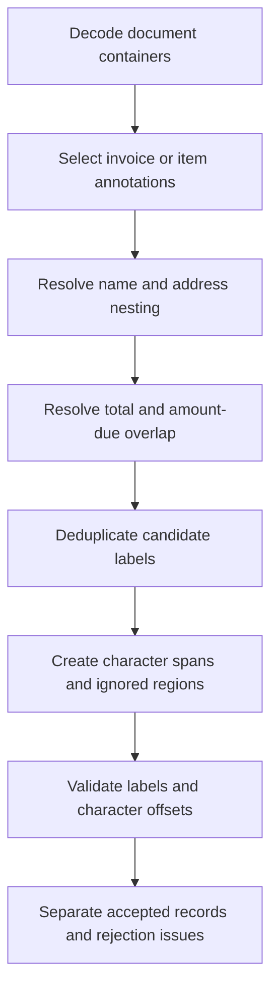
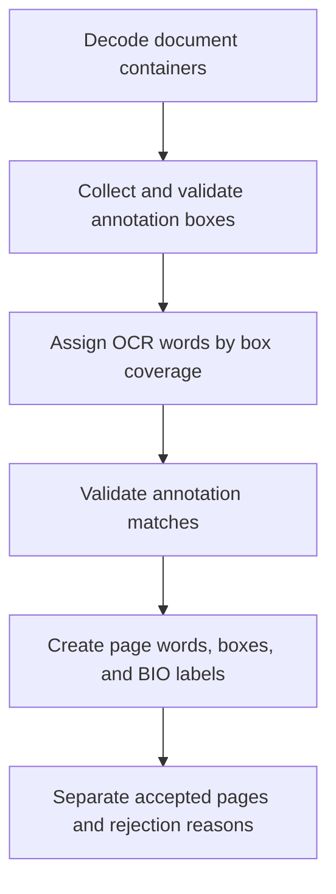

# Invoice preprocessing

[Back to OCR](../README.md) · [CLI reference](cli.md)

Downloading, reading source files, and preprocessing are separate operations.
Each preprocessing step accepts a DataFrame and returns the next DataFrame.
PipeFunc executes the steps in dependency order.

## Download and source loading

`datasets download docile` downloads and validates ZIP archives. It keeps those
archives. It does not extract them or change invoice data.

`DocileDatasetLoader` reads original OCR JSON, annotation JSON, and PDF paths.
`datasets load docile` extracts local archives if needed and saves these records
to raw Parquet. Its columns are `document_id`, `ocr_data`, `json_data`, `pdf_path`,
and available official `split` metadata. OCR and annotations use JSON strings.
PDFs remain separate files referenced by `pdf_path`.
It does not select OCR geometry, reorder words, or convert field names.

## Shared DocILE preprocessing

Run the shared source pipeline with `preprocess bert` or `preprocess layoutlm`:

```sh
uv run --env-file .env python -m commands.cli datasets download docile \
  --destination-path ./data/raw/docile --split trainval

uv run --env-file .env python -m commands.cli datasets load docile \
  --source-path ./data/raw/docile \
  --output-path ./data/raw/docile.parquet --split trainval

uv run --env-file .env python -m commands.cli preprocess bert \
  --source-path ./data/raw/docile.parquet \
  --output-path ./data/interim/docile.parquet
```



Both commands export the same model-independent invoice schema. The default
output path comes from the selected model's dataset setting. Use `--output-path`
to select another file. One export can be reused by both models. These commands
do not yet create BERT spans or LayoutLM page labels; training creates those
records in its preparation stage.

The command runs [InvoicePreprocess](../app/extraction/preprocess.py). This
shared extraction pipeline owns execution order, word ordering, and export.
It uses [DocileSource](../app/datasets/docile/preprocess.py) to read the raw
Parquet file and run DocILE-specific conversion steps. The adapter
contains no global pipeline or export writer. Each transformation is a small
callable class. The final export contains OCR
text, ordered word dictionaries, invoice annotations, PDF paths, and available
official split membership. It contains no model tokens or BIO targets.

Preprocessing reads the raw Parquet snapshot. The original OCR and annotation
JSON files are not needed for this step. The snapshot remains unchanged, and
the pipeline rejects identical input and output paths. Original PDFs are still
needed when rendering page images. Raw data and processed data have separate
paths: `DOCILE_OUTPUT_PATH` selects raw data; model dataset settings select the
processed export.

The current reading-order and annotation rules are retained. This pipeline does
not enable XY-cut or Smallest Area Wins.

## Component locations

| Location | Responsibility |
| --- | --- |
| `app/datasets/docile/` | Source download, original file loading, and DocILE format adaptation. |
| `app/extraction/preprocess.py` | Shared invoice preprocessing orchestration and export. |
| `app/extraction/order.py` | Shared OCR reading order and character-offset reconstruction. |
| `app/extraction/bert/preprocess.py` | BERT annotation projection and character spans. |
| `app/extraction/layoutlm/preprocess.py` | LayoutLM word assignment and page labels. |
| `app/pipelines/preprocess.py` | Shared DataFrame execution and partition reporting. |

## Model-specific preprocessing

Training loads the exported documents without changing their contents. It
creates the seeded train, validation, and test partitions before preprocessing
each partition. These are random document partitions, not the official split
assignments stored in the export.

[DataFramePipeline](../app/pipelines/preprocess.py) composes ordered callables
through PipeFunc. A callable must accept one argument named `frame` and return
a DataFrame. Class configuration stays on the class instance.

The shared `DecodeDocuments` step restores Python containers from JSON strings
and Parquet arrays. `DocumentStep` catches expected per-document validation
errors, records their reasons, and skips those documents in later steps.
Unexpected errors propagate to the caller.

### BERT



The steps are in [BERT preprocessing](../app/extraction/bert/preprocess.py).
The item preprocessor selects item annotations and retains item IDs. The
matching, resolution, and rejection rules are unchanged.

[BertPreprocess](../app/pipelines/bert/preprocess.py) processes each partition,
retains OCR metadata, writes rejection reports, and saves the JSON split
manifest. Tokenization and BIO token labels are created by the later dataset
step.

### LayoutLM



The steps are in [LayoutLM preprocessing](../app/extraction/layoutlm/preprocess.py).
Candidate annotations must meet the configured word-coverage threshold. Words
select the highest coverage rounded to one decimal, then the smallest annotation
area, then the lowest annotation ID. An annotation with no assigned words still
rejects the document. The report marks it as superseded when more than 80% of a
selected annotation box lies inside it on the same page; this reason does not
make the document accepted.

[LayoutLMPreprocess](../app/pipelines/layoutlm/preprocess.py) processes each
partition, writes rejection reports, and saves the CSV acceptance manifest.
Token windows and image tensors are created later.

## Image caching and training

After the common export exists, run `datasets cache-images docile` to render
the PDF pages. Then run the existing `train` or `pipeline` commands. Both local
training and ClearML stages use the same preprocessing components.

An empty accepted partition stops training after its rejection report is
written. A preprocessing error does not silently remove a source document
from the original dataset.

Record the source dataset version, preprocessing settings, code commit, and
split manifest with each experiment. Preserve the original data so another
preprocessing version can be compared against the same inputs.

## ClearML storage

ClearML storage is separate from preprocessing. Upload commands store existing
raw Parquet, processed Parquet, PDFs, and image caches as related datasets.
Preprocessing continues to read and write local files and does not need ClearML.
Upload converts PDF paths in temporary copies. Download sets local absolute PDF
paths so the existing preprocessing and training commands can use either Parquet
file directly. See [ClearML datasets](clearml_datasets.md).
