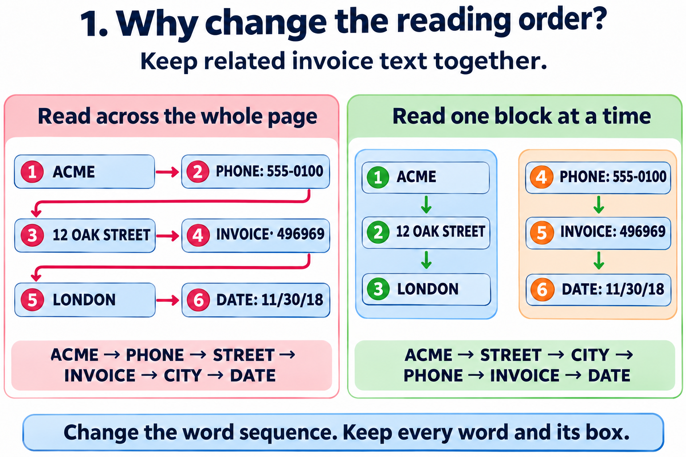
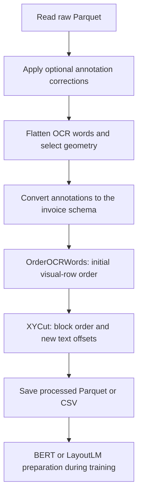
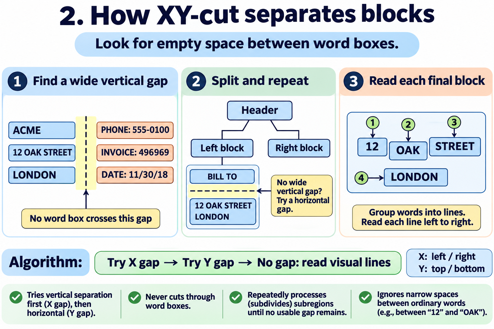
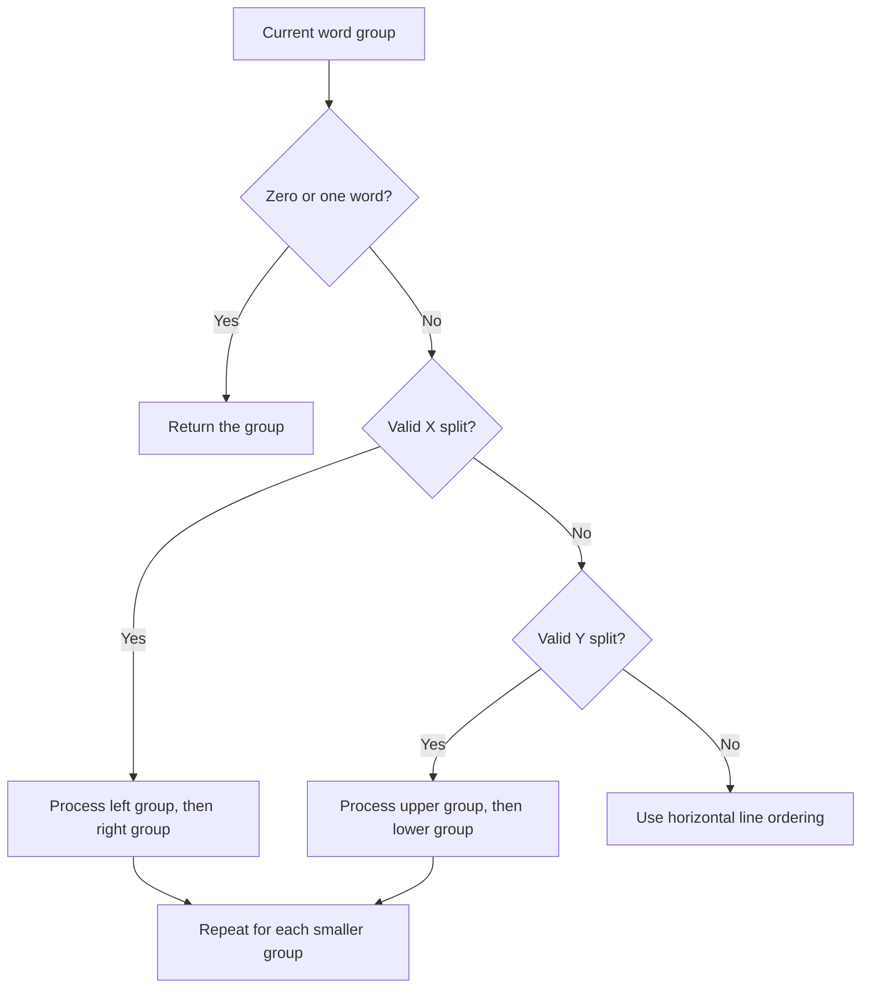
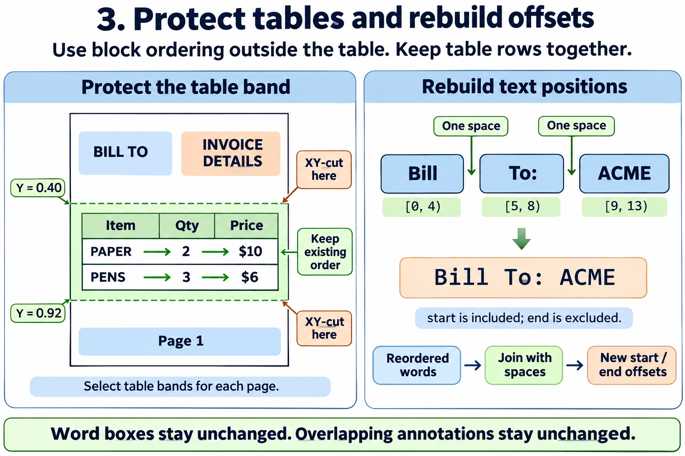

# XY-cut reading order

[Back to OCR](../README.md) · [Preprocessing pipeline](preprocessing.md)

This guide explains the implementation in
[`app/extraction/xy_cut.py`](../app/extraction/xy_cut.py).
It describes the code as it runs in this repository. Other XY-cut implementations
can choose different cut directions and different rules.

## 1. Purpose

OCR gives us words and their positions. We must also choose the order in which
those words enter the extraction model.

Reading each horizontal row across the entire page can mix separate blocks.
For example, a phone number on the right can interrupt an address on the left.
XY-cut uses empty space between word boxes to separate those blocks. It then
reads each block in turn.



In the diagram, each numbered rectangle represents a line of text. In the code,
the input records are individual OCR words.

The step changes the word sequence and character offsets. It does not change
word text, box coordinates, page numbers, or annotation boxes. It does not assign
field labels or resolve overlapping annotations.

## 2. Position in the pipeline

The shared invoice preprocessing pipeline currently runs these steps:



See [`InvoicePreprocess.pipeline()`](../app/extraction/preprocess.py).

`OrderOCRWords` supplies the initial order. It also converts `OCRWord` objects to
word dictionaries and builds the initial `ocr_text` and offsets. `XYCut` consumes
those dictionaries. Its protected table bands and skipped pages retain that
initial order.

The current shared pipeline constructs `XYCut()` with its defaults. Thus:

- XY-cut runs for both `preprocess bert` and `preprocess layoutlm`.
- Every page receives full-page XY-cut.
- No table protection is configured.
- No table detector or image model is loaded by this step.

Do not place another full-page `OrderOCRWords` step after XY-cut. That would
replace the block order with horizontal order again.

During training, model preparation creates BERT spans or LayoutLM page labels
from the saved result. XY-cut runs before those model-specific records exist.

## 3. Input and output

### Coordinates

A word box uses this format:

```text
[x0, y0, x1, y1]
```

`x0, y0` is the top-left corner. `x1, y1` is the bottom-right corner.
Coordinates are normalized to the page:

| Value | Meaning |
| --- | --- |
| X = 0 | Left edge of the page |
| X = 1 | Right edge of the page |
| Y = 0 | Top edge of the page |
| Y = 1 | Bottom edge of the page |

The code expects finite boxes with positive width and height. The XY-cut class
does not currently validate box shape, coordinate bounds, or positive area.
Validate the boxes before using it independently on other data.

### Document records

Each DataFrame row needs:

- `document_id`: the key used for optional table configuration.
- `text_with_boxes`: a sequence of word dictionaries, or a JSON string containing
  that sequence.

Each word needs at least `text`, `bbox`, `page`, and `start`. Existing `end` values
are replaced. Other word metadata is retained.

Example word:

```python
{
    "text": "ACME",
    "bbox": [0.10, 0.10, 0.20, 0.12],
    "page": 0,
    "start": 0,
    "end": 4,
}
```

`XYCut.__call__(frame)` returns a DataFrame copy. It replaces:

| Column | Result |
| --- | --- |
| `text_with_boxes` | Reordered word dictionaries with new `start` and `end` |
| `ocr_text` | Word texts joined with one space |

Other columns remain unchanged. The implementation copies word dictionaries
before updating their offsets. It does not modify the input words' offsets.

## 4. The algorithm, step by step



### Step A: restore the initial sequence and separate pages

`reorder_words()` decodes `text_with_boxes` if it is a JSON string. It copies the
word dictionaries and sorts them by their existing `start` values.

It then processes pages in numeric order. Page `0` comes before page `1`.
Words from different pages are never placed in the same XY-cut group.

### Step B: select the regions to reorder

With no table configuration, the entire page is one starting group.

With table configuration, the page is divided into content before a protected
band, the protected band itself, and content after it. Multiple bands repeat
this process from top to bottom. Section 6 explains this selection in detail.

### Step C: search for an X gap

`widest_gap(words, axis=0, minimum=min_gap_x)` looks at each word's horizontal
interval `[x0, x1]`.

It sorts the intervals from left to right and tracks the farthest right edge
reached so far. A gap exists when the next interval begins beyond that edge.
Overlapping intervals do not create a gap.

For example:

```text
Left block ends at X = 0.35
Right block starts at X = 0.60

Gap width = 0.60 - 0.35 = 0.25
Cut position = (0.60 + 0.35) / 2 = 0.475
```

The gap must be at least `min_gap_x` wide. It must be empty across the current
word group: a word box that crosses that horizontal interval blocks the cut.
The algorithm uses word boxes, not image pixels. A drawn line or logo with no
OCR word box does not block a cut.

Among qualifying X gaps, it selects the widest. If widths tie, the current
`max(gaps)` expression selects the gap with the larger midpoint: the rightmost
one for an X gap.

The words are split into two groups:

- First: words whose right edge is at or before the cut.
- Second: words whose left edge is at or after the cut.

The split is accepted only if both groups contain words and together contain
all the original words. The algorithm processes the first group completely,
then the second group.

### Step D: search for a Y gap if no X split succeeds

The same operation is applied to vertical intervals `[y0, y1]` with
`min_gap_y`. A Y gap separates an upper group from a lower group.

The upper group is processed first. For equal-width Y gaps, the gap with the
larger midpoint is selected: the lower gap.

**X has priority over Y.** The code does not compare the largest X gap with the
largest Y gap. If a valid X split exists, it uses that split even when a Y gap
would be larger.

The implementation does not use a fixed page midpoint. Each cut comes from the
empty intervals in the current group.

### Step E: repeat on each smaller group

`xy_cut_order()` calls itself for the two groups created by a cut. This is
recursion: repeat the same operation on smaller parts.



Cuts rearrange word records. They do not crop the page image or alter word boxes.

### Step F: order words inside a final block

If neither cut succeeds, `horizontal_order()` groups words into visual lines.

1. Calculate each word's vertical center: `(y0 + y1) / 2`.
2. Calculate the median word height in the current block.
3. Set the line tolerance to half that median height.
4. Sort words by vertical center, then by their left edge.
5. Compare each word's center with the median center of the last line.
6. Start a new line if that distance exceeds the tolerance.
7. Sort each completed line by its left edge.

Thus, small differences in the top coordinates of words on the same visual line
do not automatically change their left-to-right order.

The tolerance belongs to the current final block. It is not calculated once for
the entire document. The method compares with the most recent line; it does not
search all previous lines for the closest one.

## 5. Gap settings

| Setting | Default | Meaning |
| --- | --- | --- |
| `min_gap_x` | `0.04` | Minimum X gap: 4% of page width |
| `min_gap_y` | `0.03` | Minimum Y gap: 3% of page height |
| Line tolerance | Half the median block word height | Vertical distance allowed within a visual line |

The X and Y thresholds remain in normalized page units at every recursion level.
They do not shrink as a block becomes smaller. For a page 1,000 pixels wide,
`min_gap_x=0.04` corresponds to 40 pixels.

A gap equal to its threshold qualifies. Thresholds must be greater than zero and
at most one; invalid constructor values raise `ValueError`.

Lower thresholds allow more cuts. They can split related phrases into separate
blocks. Higher thresholds make fewer cuts, so independent columns can remain
mixed. These are experiment settings, not universal invoice rules.

The second diagram's narrow word spaces are ignored only when they are below
the configured threshold. The code does not recognize a space as belonging to
a phrase by its meaning.

## 6. Optional table protection



The Y values in this diagram are an example, not a scale drawing or a detected
boundary. The current algorithm does not find tables automatically.

### Configuration has two levels

The DataFrame step accepts document keys, followed by page keys:

```python
from app.extraction.xy_cut import XYCut

step = XYCut(
    table_y_ranges_by_document={
        "26f0e3a78e26450b9b47dd81": {
            0: [(0.40, 0.92)],
            1: [],
        },
    },
)
```

Page keys are integers. Page `0` is the first page. Each interval is `(top,
bottom)` in normalized Y coordinates. The document key must match `document_id`.

| DataFrame-step configuration | Behavior |
| --- | --- |
| `None`, the default | Full-page XY-cut on every document and page |
| `{}` | Preserve the existing order for every document |
| Document missing from a supplied mapping | Preserve all its pages |
| Page missing from a configured document | Preserve that page |
| Configured page with `[]` | Full-page XY-cut on that page |
| Configured page with intervals | XY-cut outside those bands; preserve words inside them |

An explicit empty mapping is therefore different from omitting the argument.
Skipped pages retain their word sequence, but all document offsets are still
rebuilt at the end.

For direct single-row calls, `reorder_words()` accepts only the page mapping:

```python
step = XYCut()

# No table protection: reorder every page.
words = step.reorder_words(row)

# Protect one band on page 0 and retain other pages' order.
words = step.reorder_words(row, table_y_ranges={0: [(0.40, 0.92)]})
```

The single-row method uses its explicit `table_y_ranges` argument. It does not
look up `table_y_ranges_by_document`; that lookup happens in `__call__()`.

### Band selection

A word belongs to a band when:

```text
top <= (word_y0 + word_y1) / 2 <= bottom
```

The code uses the word's vertical center. It does not require the entire word
box to fit in the band and does not calculate box overlap for this decision.

A band spans the full page width. Unrelated text beside a table at the same Y
positions is protected too. Full table rectangles are not currently supported.

For each band, the code:

1. Applies XY-cut to the remaining words above the band.
2. Appends the band's words in their existing `start` order.
3. Keeps the words below the band for further processing.

After the final band, it applies XY-cut to the remaining words below it.
Protection does not repair a table that already has incorrect word order.
In the shared pipeline, the preceding `OrderOCRWords` step supplies visual-row
order before protection.

Intervals are sorted before use. They must satisfy
`0 <= previous_bottom <= top < bottom <= 1`. Overlapping intervals raise
`ValueError`; the class does not merge them. Touching intervals are allowed.
A word at a shared endpoint is consumed by the earlier interval and is not
added twice.

If table ranges are saved as JSON, its object keys become strings. Convert page
keys back to integers before supplying the mapping to this class.

### Pipeline configuration

The default shared pipeline currently calls `XYCut()` directly. There is no CLI
flag for changing its thresholds or providing a table-range mapping. The examples
above configure a Python instance; they do not change the CLI's default instance.
An integration that supplies detected ranges must pass a configured instance at
that pipeline location.

## 7. Rebuild text and offsets

After all pages are ordered, the code rebuilds character offsets across the
whole document. Page boundaries do not reset the character position.

Words are joined with exactly one space. The step does not insert line breaks,
block markers, or page separators.

For example:

```text
ocr_text = "Bill To: ACME"

Bill    start = 0    end = 4
To:     start = 5    end = 8
ACME    start = 9    end = 13
```

Offsets use `[start, end)`: the start is included and the end is excluded.
The key consistency rule is:

```python
ocr_text[word["start"]:word["end"]] == word["text"]
```

`reorder_words()` returns only the new word list. `__call__()` also rebuilds
`ocr_text`. If you call the single-row method in a notebook, update both values:

```python
experiment = row.copy()
experiment["text_with_boxes"] = XYCut().reorder_words(row)
experiment["ocr_text"] = " ".join(
    word["text"] for word in experiment["text_with_boxes"]
)
```

Do not use the old OCR text with the new offsets. BERT span construction and
other code that reads character positions depend on that consistency.

## 8. Run a small experiment

Use a processed Parquet file containing word dictionaries. This is different
from running the complete CLI, which reads raw DocILE Parquet and first creates
those dictionaries.

```python
from pathlib import Path

import pandas as pd

from app.extraction.xy_cut import XYCut

frame = pd.read_parquet(
    Path("data/interim/docile-trainval-preprocessed.parquet")
)
sample = frame.loc[
    frame["document_id"].eq("26f0e3a78e26450b9b47dd81")
].copy()

reordered = XYCut()(sample)

for _, document in reordered.iterrows():
    assert all(
        document["ocr_text"][word["start"]:word["end"]] == word["text"]
        for word in document["text_with_boxes"]
    )
```

This path is an example for a shell or notebook started at the project root.
Use your notebook's `project_root` variable if its working directory is
`notebooks/`.

Compare the original and reordered word-number overlays on the same page.
Inspect addresses, key-value fields, wrapped text, and table rows. Reapplying
XY-cut to an existing processed export does not recover the order that existed
before that export; keep a baseline export if you need that comparison.

For a model comparison, keep document membership, annotation matching rules,
training settings, and evaluation rules fixed. The goal is to measure the effect
of reading order alone. The algorithm itself does not establish that model
accuracy will improve.

## 9. Limits and failure behavior

- **XY-cut uses geometry.** It does not know that a block is an address, invoice
  number, total, or line-item table.
- **No table protection by default.** Full-page XY-cut can turn a table into
  column order and separate values from their item rows.
- **No automatic reading-direction detection.** This implementation uses
  left-before-right and top-before-bottom order. Rotated or right-to-left text
  needs different handling.
- **Large boxes can prevent useful cuts.** Their intervals can cover the empty
  space between smaller text blocks. A gap must span the current word group.
- **Mixed font sizes affect line grouping.** The median-height tolerance is a
  heuristic. It can group or separate lines incorrectly.
- **Whitespace-only records are not filtered by XYCut.** Normal source
  preprocessing already removes them. Validate other inputs before use.
- **Invalid box coordinates are not checked here.** Do not treat successful
  ordering as evidence that the input geometry is valid.
- **Errors stop the shared export.** XYCut is a DataFrame callable, not a
  `DocumentStep`. Its errors do not become per-document `reason` values. The
  model-specific rejection reports are generated later during training.
- **Image and annotation errors remain separate.** Reordering does not improve
  OCR text, table detections, word-to-field coverage, or annotation geometry.

A protected band's boundaries must be supplied from outside this algorithm.
They can come from a detector, an OCR-layout heuristic, or a manual experiment.
Use inputs that are also available during inference if you compare trained
models. The present shared pipeline does not invoke Heron or another detector.

## 10. Code map

| Method | Responsibility |
| --- | --- |
| `__post_init__` | Validate X and Y gap thresholds |
| `word_center_y` | Calculate a word's vertical center |
| `widest_gap` | Find the widest qualifying interval gap on one axis |
| `horizontal_order` | Group visual lines and read their words left to right |
| `xy_cut_order` | Recursively split a word group, with X priority |
| `reorder_words` | Process pages and optional table bands; rebuild offsets |
| `__call__` | Look up document configuration and update DataFrame columns |

Related code: [initial reading order](../app/extraction/order.py),
[shared export pipeline](../app/extraction/preprocess.py), and
[LayoutLM label preparation](../app/extraction/layoutlm/preprocess.py).
